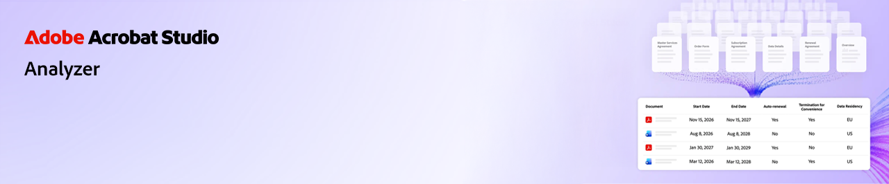
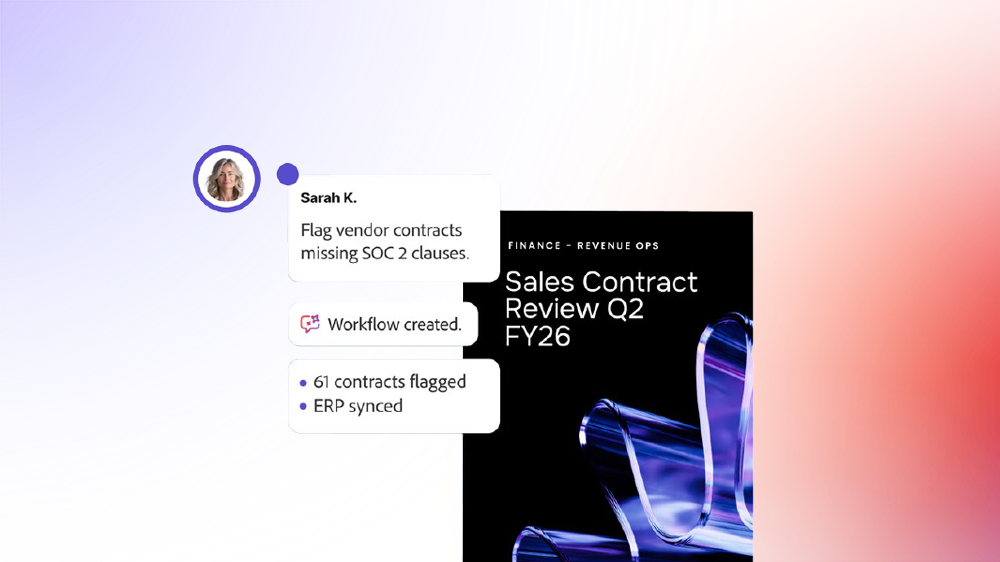
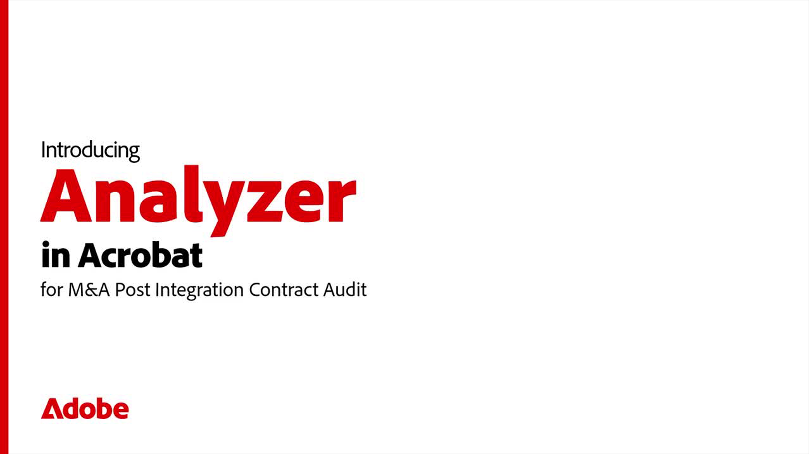
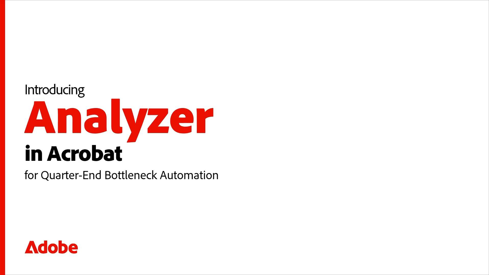

# Présentation d’Analyzer dans Acrobat Studio

Découvrez comment utiliser Analyzer dans Acrobat Studio pour transformer des documents complexes en informations claires. Ces courts tutoriels vous aident à démarrer, à explorer les fonctionnalités avancées et à voir des cas d’utilisation réels.

[!BADGE Informatif]{type=Watch overview video url="https://video.tv.adobe.com/v/3503972"}

## Nouveautés

>[!BEGINTABS]

>[!TAB Commencer]

[Commencez](get-started.md) à apprendre à extraire des données structurées et citées de grands volumes de documents.

>[!TAB Utiliser les collections]

Découvrez comment créer des [collections](collections.md) manuelles et liées, appliquer des attributs et organiser les documents au fur et à mesure que votre contenu se développe.

>[!TAB Utilisation des attributs]

Découvrez comment créer, tester et affiner les [attributs](attributes.md) avec Analyzer dans Acrobat Studio.

>[!TAB Découvrir les fonctionnalités avancées]

Découvrez comment [exporter les données extraites, partager une collection, comparer deux documents et utiliser l&#39;Assistant IA](advanced.md) pour des questions rapides et ad hoc.

>[!TAB Cas d’utilisation en action]

Découvrez les [cas d’utilisation](use-cases/use-case-overview.md) réels et comment différentes équipes utilisent Analyzer dans Acrobat Studio pour travailler plus intelligemment et plus rapidement.

>[!ENDTABS]

## Essentials

Initiez-vous aux bases. Apprenez à utiliser Analyzer dans Acrobat Studio pour comprendre rapidement vos documents, les résumer et interagir avec eux.

<table style="table-layout:fixed">
<tr>
  <td>
    
    

    <a href="get-started.md"><strong>Commencer</strong></a>
    

    Découvrez comment Analyzer vous aide à extraire des données structurées et citées de grands volumes de documents dans Acrobat Studio
     
  </td>
  <td>
    
    

    <a href="collections.md"><strong>Utiliser les collections</strong></a>
    

    Découvrez comment créer des collections manuelles et liées, appliquer des attributs et organiser les documents au fur et à mesure que votre contenu se développe
     
  </td>
  <td>
    
    

    <a href="attributes.md"><strong>Utilisation des attributs</strong></a>
    

    Découvrez comment créer, tester et affiner des attributs avec Analyzer dans Acrobat Studio
     
  </td>
  <td>
    
    

    <a href="advanced.md"><strong>Découvrir les fonctionnalités avancées</strong></a>
    

    Découvrez comment exporter les données extraites, partager une collection, comparer deux documents et utiliser l'assistant AI pour poser des questions rapides et ad hoc
     
  </td>
</tr>
</table>

## Cas d’utilisation en action

Voir les scénarios réels. Découvrez comment différentes équipes utilisent Analyzer dans Acrobat Studio pour travailler plus intelligemment et plus rapidement.

<table style="table-layout:fixed">
<tr>
  <td>
    
    

    <a href="use-cases/m-and-a-post-audit.md"><strong>Fusion et acquisition : audit des contrats après une acquisition</strong></a>
    

    Découvrez comment les équipes de fusions et acquisitions peuvent analyser de grands ensembles de contrats pour identifier les obligations clés, les conditions et les risques potentiels en quelques minutes au lieu de plusieurs semaines
     
  </td>
  <td>
    
    

    <a href="use-cases/accelerate-revenue.md"><strong>Finance : examiner les contrats pour la constatation et les audits des produits</strong></a>
    

    Découvrez comment les équipes financières peuvent se préparer aux audits, prendre en charge la constatation des produits et identifier les risques comptables plus rapidement
     
  </td>
  <td>
    
    

    <a href="use-cases/data-privacy-risk.md"><strong>Confidentialité et sécurité des informations : consultez les accords de confidentialité des données</strong></a>
    

    Découvrez comment les équipes chargées de la confidentialité et de la sécurité des informations peuvent identifier les lacunes de conformité et valider les obligations avec des résultats traçables
     
  </td>
  <td>
    
    

    <a href="use-cases/identify-margin-erosion.md"><strong>Construction : recherche de risques de marge dans les sous-traitants</strong></a>
    

    Découvrez comment les équipes de construction et de projet peuvent trouver les ordres de modification manqués, les DDR vieillissantes et les lacunes dans les protections de sous-traitance avant qu'ils n'affectent les marges
     
  </td>
<tr>
<td>
    
    

    <a href="use-cases/vendor-risk.md"><strong>Audit de la sécurité des informations : identification du risque fournisseur</strong></a>
    

    Découvrez comment identifier de manière proactive les risques de sécurité des informations liés aux contrats fournisseur
     
  </td>
  <td>
    
    

     
  </td>
  <td>
    
    

     
  </td>
  <td>
    
    

     
  </td>
</tr>
</tr>
</table>